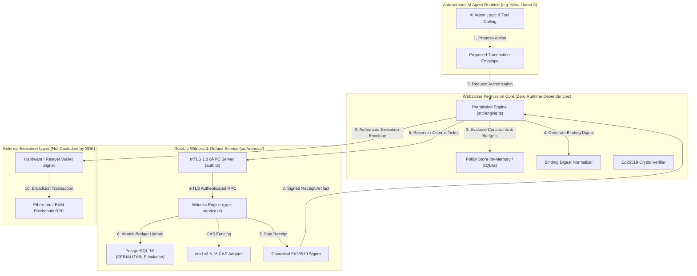

# Web3User Permission Lab — Meta Global AI Developer Hackathon

[](https://opensource.org/licenses/Apache-2.0)
[](https://nodejs.org/)
[]()
[]()

> **Deterministic Pre-Execution Authorization & Financial Guardrails for Autonomous AI Agents**

Web3User Permission Lab is an open-source, local-first **off-chain transaction authorization and policy-governance SDK** engineered for Node.js (`>=22.13.0`) with zero external runtime dependencies in its core engine.

Built for autonomous agent runtimes, wallet middleware, and dApp transaction relayers, Web3User provides mathematical certainty before irreversible actions occur:
1. **Evaluates Candidate Transactions:** Validates action parameters against declarative rules and rolling cumulative spending budgets.
2. **Generates Tamper-Evident Artifacts:** Signs versioned, cryptographically bound authorization receipts using Ed25519 digital signatures.
3. **Enforces Atomic Single-Use Replay Prevention:** Bounded by SQLite Write-Ahead Logging (WAL) and monotonic timekeeping to prevent double-spending or replayed prompts.

---

## The Problem: The Unconstrained Autonomous Agent

As autonomous AI agents (powered by large language models like Meta Llama 3) transition from text generators to economic actors capable of signing Web3 transactions and invoking financial APIs, they introduce critical security challenges:
- **Prompt Injection & Goal Hijacking:** Malicious inputs can trick an agent into executing unauthorized transactions or draining funds.
- **Hallucinated Execution Loops:** Logic loops in agent reasoning can repeatedly trigger transactions, exhausting wallet balances within seconds.
- **Double-Spend & Mempool Race Conditions:** Asynchronous agent workers can issue conflicting transactions without deterministic sequencing.
- **The "All-or-Nothing" Private Key Trap:** Giving an agent raw private key access grants unconstrained signing authority over all wallet assets.

**Web3User solves this by placing a deterministic, mathematically verifiable boundary between the AI agent's intent and the wallet's signing key.**

---

## Core Capabilities

### 1. Deterministic Policy Evaluation & Cumulative Budgets
Policies define granular execution boundaries:
- **Target Filtering:** Strict whitelisting of recipient addresses and smart contract function selectors.
- **Per-Action Ceilings:** Inclusive `maxAmount` constraints on individual transactions.
- **Rolling Cumulative Budgets:** Stateful budget windows (`HOURLY`, `DAILY`) tracked atomically in transactional storage, ensuring an agent cannot exceed spending limits even across hundreds of micro-transactions.

### 2. Parameter Binding Digest (`bindingDigest`)
Authorizations are cryptographically bound to exact transaction parameters (chain ID, target contract, value, calldata, policy revision). Altering even a single bit of the transaction payload invalidates the authorization.

### 3. Monotonic Witness & Replay Prevention
Authorization tokens have a strict single-use lifecycle (`REQUESTED` $\to$ `COMMITTED` $\to$ `CONSUMED`). Consumption is durable and permanent in SQLite or PostgreSQL, eliminating transaction replay attacks.

### 4. Canonical Ed25519 Receipt Signing
The witness signs a canonical, length-prefixed receipt preimage with Ed25519 digital signatures. Verifiers confirm that the authorization was issued by an authentic witness holding an active epoch lease.

### 5. Milestone 13-D Microservice & Consensus Foundation
- **gRPC Witness Microservice:** Pure Node.js `@grpc/grpc-js` transport with mTLS 1.3 socket peer extraction and role-based access control (RBAC).
- **PostgreSQL 16 Storage Engine:** ACID transactions with `SERIALIZABLE` isolation, deterministic row locks (`FOR UPDATE NOWAIT`), and append-only consensus logging.
- **Single-Node Real-etcd Integration:** Validated wire-protocol integration with official `etcd v3.5.18` enforcing linearizable quorum reads and atomic Compare-and-Swap (CAS) transactions.

---

## Architecture Overview



---

## Important Scope & Trust Boundaries

> [!IMPORTANT]
> **Web3User is an off-chain decision and authorization engine, NOT an on-chain smart contract, validator, or wallet custody system.**
> - **No Wallet Private Key Custody:** Web3User does not custody wallet private keys (secp256k1), manage gas, or broadcast transactions to blockchain mempools.
> - **Authorization $\ne$ Settlement:** An `ALLOW` decision indicates compliance with off-chain policy; the integrating application or relayer remains responsible for separate wallet signing and network broadcast.
> - **Permanent Consumption:** Once marked `consumed` in the durable witness, an authorization cannot be refunded or reused if downstream blockchain submission fails or reverts on-chain.
> - **Production Status:** Development release candidate (`v0.1.0-rc.1`). Intended for hackathon demonstration, integration testing, and research.

---

## Getting Started

### Prerequisites
- **Node.js:** `>=22.13.0` (Development baseline pinned to Node.js `26.11.1` in `.nvmrc`).
- **npm:** Baseline `11.20.0` or compatible.
- **Docker & Docker Compose:** Required for containerized verification.

### Installation
Clone the repository and install locked dependencies:

```bash
git clone https://github.com/syedsenterprises/Web3User-Meta-Hackathon.git
cd Web3User-Meta-Hackathon
npm ci
```

### Build & Typecheck
```bash
npm run build
npx tsc --noEmit
```

### Running Tests
Web3User features an exhaustive test suite with over 680 tests across 33 test suites:

```bash
# Run all core engine, crypto, policy, and witness test suites
npm test

# Run interactive persistent replay demo
npm run demo:persistent-replay -- --verify

# Run basic authorization example
npx tsx examples/basic-authorization.ts
```

### Docker Verification (Isolated Container Runner)
To verify the entire SDK in a clean, isolated Linux container environment against an ephemeral PostgreSQL service:

```bash
docker compose up --build --abort-on-container-exit --exit-code-from tester
docker compose down -v
```

---

## Interactive Browser Demonstration (`website-preview/`)

The repository includes a client-side visual evaluator in `website-preview/index.html`. It demonstrates:
- Declarative policy editing and constraint validation.
- Real-time parameter tampering detection.
- Rolling cumulative budget exhaustion.
- Single-use replay protection.

To run the local preview:
```bash
npx serve website-preview
# Open http://localhost:3000 in your browser
```

---

## Meta AI Model Integration: Muse Spark Policy Assistant

Web3User includes an isolated AI governance module (`src/meta-ai/`) powered by Meta's official model API endpoint:
- **Base URL:** `https://api.meta.ai/v1`
- **Endpoint:** `/chat/completions`
- **Model:** `muse-spark-1.3` (configurable default)
- **Authentication:** Bearer token via `MODEL_API_KEY` environment variable

The Policy Assistant enables developers and operators to describe complex authorization rules in plain English:
> *"Allow an autonomous agent to spend at most 0.25 ETH per transaction, with a cumulative daily budget of 2 ETH, on contract 0xa0b86991c6218b36c1d19d4a2e9eb0ce3606eb48 to 0x2222222222222222222222222222222222222222."*

Meta's `muse-spark-1.3` translates this intent into a strongly-typed, schema-validated `DemoPolicy` object.

### Strict Security Architecture & AI Trust Boundaries

To prevent prompt injection, hallucinated permissions, or unauthorized transaction execution, the Meta AI integration enforces 10 strict invariants:

1. **AI Output is Untrusted Input:** Model responses are strictly treated as unverified candidate proposals.
2. **No Transaction Approval:** The AI assistant cannot issue `ALLOW` decisions or approve transactions.
3. **No Transaction Execution:** The AI assistant has zero execution authority and cannot broadcast transactions.
4. **No Receipt Signing:** The AI module has zero access to cryptographic witness keys or Ed25519 signers.
5. **No Direct Policy Mutation:** AI proposals cannot modify active policy stores without human intervention.
6. **No Bypassing Determinism:** All candidate policies must pass strict schema validation (`normalizeDemoPolicy`).
7. **No Witness State Alteration:** The AI module cannot allocate sequence numbers, acquire leases, or mutate consensus state.
8. **Fail-Closed on Invariants:** Malformed JSON, negative limits, invalid hex addresses, or timestamp inversions fail closed immediately.
9. **Explicit Human Review Gate:** Every generated proposal requires explicit human approval before being loaded or saved.
10. **Deterministic Enforcement Supremacy:** The deterministic Web3User policy engine remains the sole, final authority.

### Configuration & Credential Requirements

To use the live Meta Model API:
```bash
# Set your Meta AI API key in the environment
export MODEL_API_KEY="your-meta-bearer-token"

# Start the local preview server
npm run preview:server
```

> [!NOTE]
> **API Key Safety:** `MODEL_API_KEY` is maintained strictly on the server backend (`scripts/preview-server.mjs`) and is **never** exposed to frontend JavaScript or client browsers. All requests are bounded by a 15-second timeout and a 2,000-character input limit.

### Safe Offline Simulation Fallback

When `MODEL_API_KEY` is not present in the environment:
- The preview server operates in **Safe Offline Simulation Mode**.
- Natural-language requests are parsed using deterministic offline templates so you can test the UI review and approval workflow locally without external API dependencies.
- Proposals generated in offline mode are explicitly flagged with `isLiveApi: false` in the UI and response metadata.

### Running the Interactive Preview Server

```bash
# Build the TypeScript project
npm run build

# Launch the preview server with the AI Policy Assistant bridge
npm run preview:server

# Open http://localhost:3000 in your browser to test the interactive playground
```

---

## Engineering Roadmap

- [x] **Milestones 0–8:** Core evaluator, SQLite persistence, Ed25519 signing, budget windows.
- [x] **Milestone 9–10:** Multi-process write contention hardening, crash recovery.
- [x] **Milestone 11–13-C.1:** Monotonic witness adapter, startup reconciliation, PostgreSQL serializable storage.
- [x] **Milestone 13-D Stage 2-A.2:** Single-node real etcd integration (CAS transactions, linearizable reads).
- [ ] **Milestone 13-D Stage 2-B:** Multi-node consensus state machine & lease synchronization (open developmental gate; live authorization remains on single-node authority).
- [ ] **Meta Hackathon Track (Isolated Integration):** Meta Muse Spark (`muse-spark-1.3`) natural-language policy assistant with strict schema validation and explicit human review gates (isolated module under `src/meta-ai/`; live API verification pending user credential provisioning).
- [ ] **Future Proposal:** Meta Llama 3 Semantic Pre-Execution Risk Analyzer & automated plain-language audit logs.

---

## License & Attribution

Web3User Permission Lab is released under the **Apache-2.0 License**.  
Copyright 2026 Syed Shahed. See [LICENSE](LICENSE) and [NOTICE](NOTICE) for details.
